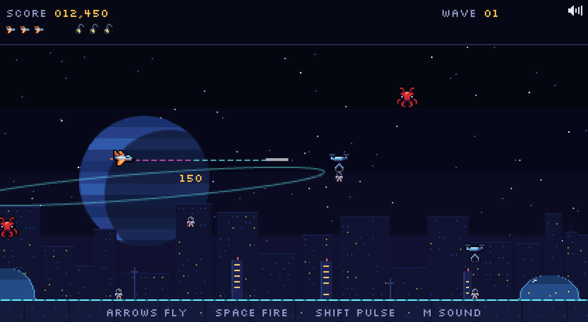

<div align="center">

# Sentinel

**Hold the ring. Shoot the Snatchers. Catch the colonists.**

A side-scrolling patrol shooter on a looping orbital ring. It runs in the browser with a keyboard and mouse, a controller, or touch on a phone.

### [▶ Play it now](https://leeeeeroyj.github.io/sentinel/)

[](https://github.com/leeeeeroyj/sentinel/actions/workflows/deploy.yml)


[](LICENSE)



</div>

## About

Sentinel is an original arcade game inspired by the mechanics of Williams Electronics' 1981 arcade game *Defender*. You fly patrol round an orbital colony ring, eight screens around, that loops with no edges. Drones called Snatchers drop onto the colonists walking the hull and carry them off. Shoot them down, catch whoever falls, and set them back down safely.

- **A world that loops.** Fly far enough either way and you come back round to where you started. The hull's domes, towers and masts repeat every lap, so you learn the ring as you play.
- **Push the way you want to go.** No thrust or reverse buttons: push left or right to fly and face that way, and the view swings ahead of you when you turn.
- **Rescue, not just shooting.** Every abduction is a race. Hit a Snatcher low and its catch drops safely; hit it high and you'd better be underneath.
- **Warning before harm.** New hostiles fade in inside a closing ring, harmless until they're solid, and shooters flash white just before they fire.
- **Sound with no audio files.** Sound effects are generated in code, sfxr style, when the game loads.

## How to play

Ten colonists walk the hull. Snatchers seek them out, drop onto them and climb slowly away. If a Snatcher reaches the top of the sky, it fuses with its catch into a Husk and that colonist is gone.

- **Shoot a Snatcher that's lifting someone** and the colonist falls.
- **Catch them in mid-air** for 500, then **fly them down to the hull** for 500 more.
- **A short fall** (80 px, five tiles, or less) they survive on their own, for 250. From any higher, they're lost.
- **Ramming a hostile** destroys it, but costs you a ship. You start with 3. After a respawn your craft blinks and can't be hit for 2 seconds.

- **Hostiles shoot** when they're on screen. Each one flashes white just before it fires an aimed shot.
- **The pulse** destroys everything on screen, including mines and shots, and scores every kill. You start with 3, and the HUD shows how many are left.
- **Waves.** Each wave brings more Snatchers and Minelayers, a little faster and shooting more often. Clear every Snatcher, Husk and Minelayer to end it. Each colonist still alive pays a bonus of 100 × the wave number (up to 500 each).
- **Don't dawdle.** Take too long on a wave and the HOUND lamp blinks: Hounds start warping in near you, one every 10 seconds, until the wave ends.
- **Lose every colonist** and the ring goes dark: every Snatcher fuses into a Husk and new arrivals come as Husks. Waves 5, 10, 15 and so on bring back all ten colonists and the lights.
- **Every 10,000 points** earns an extra ship and an extra pulse.
- **High score:** your best is kept in this browser and shown on the title and at game over.
- **Attract mode:** add `?attract` to the address for a silent demo that flies, rescues and fights by itself from a different wave each time, and ignores input. `?attract&seed=<n>` picks the starting wave.

The scanner across the top shows the whole ring, centred on you, and an amber arrow on the screen's edge points to anyone being carried off out of sight.

| Hostile | Points | Behaviour |
| --- | ---: | --- |
| Snatcher | 150 | Drifts over the nearest colonist, drops onto them and lifts them away. |
| Husk | 150 | A Snatcher fused with its catch. Twitchy: it homes in on you, never in a straight line. |
| Minelayer | 250 | Cruises round the ring, leaving mines behind it. It never shoots. |
| Hound | 200 | Arrives when a wave drags on. It hunts you hard but swings wide when you turn. |
| Mine | — | Hangs in the air for 6 seconds. Lasers pass straight through it, so only the pulse clears it. |

| Rescue | Points |
| --- | ---: |
| Catch a falling colonist | 500 |
| Set them down on the hull | 500 |
| A colonist survives a short fall | 250 |

## Controls

| | Keyboard + mouse | Controller | Touch |
| --- | --- | --- | --- |
| Fly and turn | ← → or A D | Left stick or D-pad | Left stick |
| Climb and dive | ↑ ↓ or W S | Left stick or D-pad | Left stick |
| Fire | Hold Space, J or left click | Hold A, RT or RB | Hold **FIRE** |
| Pulse | Shift, K or right click | B, LT or LB | Tap **PULSE** |
| Pause | P | Start | Tap **II** (top left, after the score) |
| Sound on / off | M, or click the speaker (top right) | Y | Tap the speaker |
| Start | Enter or Space, or click **START** | A or Start | Tap **START** |
| Back to the title | Esc | Back | **TITLE** when paused or on the game-over screen |

A weak push nudges the craft without turning it. The game pauses itself if you switch away. Controllers show up once you press a button. On a phone, play in landscape: on wide screens the touch controls sit in the bars beside the game.

## Run it locally

You need [Node.js](https://nodejs.org/) 20.19+ or 22.12+.

```bash
npm install
npm run dev        # http://localhost:5173
npm run build      # type-check and build to dist/
```

Every push to `main` builds the game and deploys it to GitHub Pages.

## Project layout

```
src/
  main.ts            game setup
  config.ts          tunables: ring size, flight, hostiles, waves, points, colours
  world.ts           ring maths (wrap-around distance) and the seeded generator
  backdrop.ts        stars, planet, skyline and the hull, baked to tiling textures
  waves.ts           the wave table: counts, pace, bonuses
  entities/          colonists and hostiles
  controls.ts        keyboard, mouse, gamepad and touch input
  touch.ts           on-screen stick and buttons for phones
  effects.ts         sparks, shockwaves, shake and screen wobble
  sfx.ts             procedural sound effects
  hi.ts              the high score, kept in localStorage
  attract.ts         the ?attract demo mode's settings
  scenes/            title screen, the ring and the HUD
assets/sprites/      the game's 16 × 16 sprites
design/              concept sheet and build plan
tools/sprites.py     sprite search and export script
tools/m*-test.mjs    headless Chrome checks for each milestone
tools/cdp.mjs        shared headless Chrome harness for the newer tests
tools/pause-hi-test.mjs  checks pause and the high score
tools/attract-test.mjs   checks the ?attract demo
```

## Credits

- **Sprites:** from the CC0 [Angais/pixel-art-atlas-1.4m](https://huggingface.co/datasets/Angais/pixel-art-atlas-1.4m) collection of AI-generated pixel art, found with [Pixel Search](https://huggingface.co/spaces/cfahlgren1/pixel-search).
- **Font:** [Silkscreen](https://fonts.google.com/specimen/Silkscreen) by Jason Kottke (SIL Open Font License).
- **Engine:** [Phaser](https://phaser.io/).
- **Inspiration:** Williams Electronics' *Defender*. Sentinel is an original game and isn't affiliated with or endorsed by the original's rights holders.

## License

The code is released under the [MIT License](LICENSE). The sprites in `assets/sprites/` and `design/` are CC0 (public domain), and the Silkscreen font is under the SIL Open Font License.
